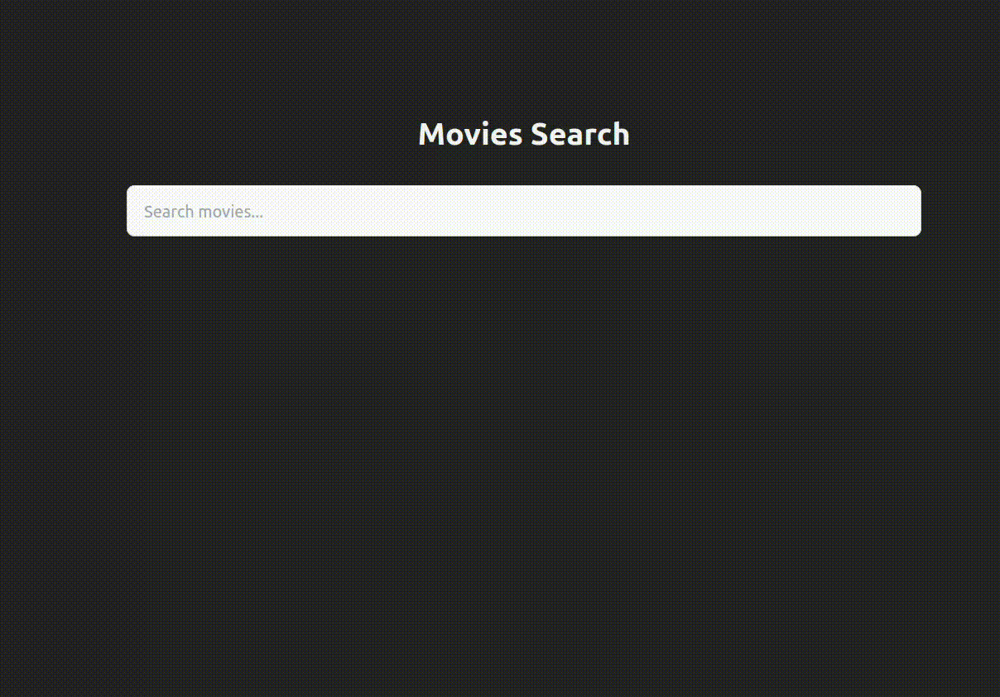

# Hybrid Movie Recommender — Content Meets Collaborative Filtering



A web application for finding movies similar to one you choose. You can search for a movie, view its details, and browse recommendations based on movie content and audience ratings.

The recommendation engine blends **Elasticsearch content similarity** with **Alternating Least Squares (ALS) collaborative filtering**, trained from MovieLens ratings. A Vue interface connects the ranking pipeline to movie posters, descriptions, and a browsable recommendation carousel.

## Highlights

- **Two complementary recommendation signals:** movie titles, genres, and user tags provide content similarity; audience ratings provide learned relationships between movies.
- **An end-to-end recommendation pipeline:** data ingestion, sparse matrix construction, model training, candidate retrieval, score blending, and API delivery.
- **MovieLens 32M as the source dataset**, with a prepared Elasticsearch catalog containing **40,405 movies**.
- **Interactive discovery:** debounced autocomplete, movie details, and ten hybrid recommendations per selected title.
- **Separate offline and online workloads:** ALS factors are trained once and persisted; requests retrieve similar items and combine their scores with content relevance.
- **A containerized stack:** FastAPI, Vue, Elasticsearch, PostgreSQL, and persistent Docker volumes.

## How It Works

The system answers two questions for the movie you select:

1. **Which movies have similar content?** Elasticsearch compares the title, genres, and tags of the selected movie with the indexed catalog.
2. **Which movies have similar audience rating patterns?** ALS learns a compact representation of each movie from the user–movie rating matrix and retrieves nearby movies in that learned space.

The API merges both candidate lists, blends their scores, removes the selected movie, and returns the highest-ranked results. Clicking a recommendation starts another discovery step.

This is an **item-to-item recommender**: historical users supply the training signal, while the application recommends from a selected movie without requiring a signed-in user or a personal rating history.

## Architecture

```text
MovieLens CSV files                     Prepared movie catalog
        |                                        |
        v                                        v
PostgreSQL ratings                         Elasticsearch
        |                                  /          \
        v                         Autocomplete       Content similarity
Sparse user–item matrix                                  |
        |                                                |
        v                                                |
ALS training → persisted model → Item similarity         |
                                      \                 /
                                       v               v
                                     FastAPI hybrid ranking
                                               |
                                               v
                                    Vue movie discovery UI
                                               |
                                               v
                                    TMDB details and posters
```

PostgreSQL stores the rating interactions used for training. Elasticsearch stores searchable movie metadata and supplies content candidates. FastAPI loads the ALS model into application state and serves the search, movie, and recommendation endpoints. The browser retrieves detailed movie information directly from TMDB.

## Tech Stack

| Area | Technologies |
| --- | --- |
| Frontend | Vue 3, Vue Router, JavaScript, Vite 7, Tailwind CSS 3, Axios |
| API | Python 3.11, FastAPI, Uvicorn |
| Collaborative filtering | `implicit`, ALS, NumPy, SciPy sparse matrices |
| Data ingestion | pandas, SQLAlchemy, psycopg2, PostgreSQL `COPY` |
| Search and content retrieval | Elasticsearch OSS 7.10.2, Elasticsearch Python client 7.13 |
| Rating storage | PostgreSQL 16 |
| Movie enrichment | TMDB API and image service |
| Delivery | Docker Compose, Nginx; Traefik routing in the deployment configuration |

## Quick Start

### Requirements

- Docker and Docker Compose.
- Python 3 with `venv` support and pandas for the data preparation step below.
- MovieLens ratings, or an existing prepared `api/dataset/ratings_clean.csv`.
- A [TMDB API Read Access Token](https://developer.themoviedb.org/docs/authentication-application) for the movie detail view. The application uses Bearer authentication.

Run the following commands from the repository root. The first startup imports the data and trains ALS, so startup time and memory requirements depend on the size of the ratings file.

### 1. Prepare the ratings

The enriched catalog is already tracked at [`api/elastic_module/movies_with_tags.ndjson`](api/elastic_module/movies_with_tags.ndjson). The CSV dataset is excluded from Git and must be provided separately.

Download [MovieLens 32M from GroupLens](https://grouplens.org/datasets/movielens/32m/) and place its `ratings.csv` in `api/dataset/`. If you already have `ratings_clean.csv`, skip this step after checking its columns.

The following preparation keeps ratings for movies in the bundled catalog and preserves the column order expected by the PostgreSQL importer:

```bash
python3 -m venv /tmp/recsys-data-env
/tmp/recsys-data-env/bin/python -m pip install pandas
mkdir -p api/dataset

/tmp/recsys-data-env/bin/python - <<'PY'
import json
from pathlib import Path
import pandas as pd

catalog = Path("api/elastic_module/movies_with_tags.ndjson")
with catalog.open(encoding="utf-8") as source:
    movie_ids = {
        json.loads(line)["movieId"]
        for position, line in enumerate(source)
        if position % 2 == 1
    }

output = Path("api/dataset/ratings_clean.csv")
columns = ["userId", "movieId", "rating", "timestamp"]
pd.DataFrame(columns=columns).to_csv(output, index=False)
for chunk in pd.read_csv("api/dataset/ratings.csv", chunksize=500_000):
    filtered = chunk.loc[chunk["movieId"].isin(movie_ids), columns]
    filtered.to_csv(output, mode="a", header=False, index=False)
print(f"Prepared {output}")
PY
```

The importer explicitly removes `timestamp`, so the prepared CSV must still contain it. Movie IDs must agree with the catalog. The preparation above reuses the bundled catalog rather than regenerating metadata through TMDB.

### 2. Configure the application

Create a root `.env` file:

```dotenv
POSTGRES_USER=stiigp
POSTGRES_PASSWORD=recsys
POSTGRES_DB=recsys
```

These values match the current database connection in [`api/postgres_module/db.py`](api/postgres_module/db.py) and the Compose health check. Changing the environment variables alone does not change the API's hardcoded connection.

Create `frontend/.env`:

```dotenv
VITE_API_URL=http://localhost:8000
VITE_TMDB_API_KEY=your_tmdb_api_read_access_token
```

Vite embeds these values during the frontend build. `VITE_TMDB_API_KEY` is used by the browser and is visible in the built application. Rebuild the frontend after changing it.

### 3. Build and start the local stack

```bash
docker compose -f docker-compose-dev.yaml build api
docker compose -f docker-compose-dev.yaml build \
  --build-arg VITE_API_URL=http://localhost:8000 frontend
docker compose -f docker-compose-dev.yaml up -d --no-build
```

The explicit build argument overrides the hosted API URL currently set in the Compose file. Despite its name, `docker-compose-dev.yaml` serves the compiled frontend through Nginx; it does not start Vite with hot reload.

Follow the import and training progress:

```bash
docker compose -f docker-compose-dev.yaml logs -f api
```

Once API startup completes, open:

- **Application:** [http://localhost:3000](http://localhost:3000)
- **Interactive API docs:** [http://localhost:8000/docs](http://localhost:8000/docs)
- **API status:** [http://localhost:8000/](http://localhost:8000/)

### Stop the stack

```bash
docker compose -f docker-compose-dev.yaml down
```

The database, Elasticsearch index, and model artifacts remain in named volumes for subsequent runs.

## How to Use It

1. Enter at least three characters in the movie search field.
2. Select a suggestion to open its movie page.
3. Explore the synopsis, genres, release year, runtime, and poster supplied by TMDB.
4. Browse the **Recommended based on this** carousel.
5. Select another movie to continue exploring the recommendation graph.

Autocomplete waits 200 ms after input before requesting suggestions and returns up to ten matches. The carousel requests ten hybrid recommendations whenever the selected movie changes.

## Recommendation Engine

### Collaborative filtering: sparse ALS

[`api/recs/cf.py`](api/recs/cf.py) reads PostgreSQL ratings in chunks of **1,000,000 rows**, creates sorted user and movie ID mappings, and builds a SciPy COO matrix converted to CSR. Users occupy rows and movies occupy columns.

The training configuration is:

| Parameter | Value |
| --- | --- |
| Latent factors | 64 |
| Regularization | 0.01 |
| Training iterations | 30 |
| Rating multiplier | 20.0 |
| Matrix dtype for fitting | `float32` |

Although MovieLens supplies explicit star ratings, the implementation feeds `rating × 20` into the `implicit` ALS model as confidence values. It does not center ratings or convert low ratings into negative preferences; every observed positive rating contributes a positive interaction.

The online path calls `model.similar_items(...)` to retrieve movies from the learned item factors. It does not call the model's user recommendation method.

Chunked SQL reads reduce the size of each read, but matrix construction still accumulates all row indices, column indices, and values before building the sparse matrix. Memory usage therefore grows with the complete interaction dataset.

### Content-based filtering: Elasticsearch

[`api/recs/cbf.py`](api/recs/cbf.py) uses a `more_like_this` query with the selected movie document as its reference:

| Setting | Value |
| --- | --- |
| Fields | `title`, `genres`, `tags` |
| Minimum term frequency | 1 |
| Maximum query terms | 25 |
| Hybrid candidate count | Up to 200 |
| Standalone content candidate count | Up to 20 |

The movie index maps titles and tags as text and genres as keywords. Tags also have a keyword subfield. The active query returns Elasticsearch relevance scores without applying the optional rating-based `function_score` query defined in the same module.

### Hybrid candidate merging and ranking

[`api/main.py`](api/main.py) implements the hybrid endpoint:

1. Retrieve up to **200 ALS neighbors** of the selected movie.
2. Retrieve up to **200 content matches** from Elasticsearch.
3. Merge the candidate sets; content-only candidates receive a collaborative score of zero.
4. Fetch titles, TMDB IDs, and poster paths in one Elasticsearch `mget` request.
5. Exclude the selected movie, blend scores, sort descending, and return the requested number of results.

For a candidate movie, the implemented score is:

```text
hybrid_score = 0.40 × (content_score / maximum_content_score)
             + 0.60 × collaborative_similarity
```

Candidates outside the content result set receive a content score of zero. Content scores are normalized by the highest content score for the current request; the collaborative similarity is used directly. The **40% content / 60% collaborative** weighting is fixed in the endpoint.

These scores express ranking relevance for a selected movie. They are not predicted star ratings or calibrated probabilities.

## Data and Model Lifecycle

The source is [MovieLens 32M](https://grouplens.org/datasets/movielens/32m/), a benchmark with roughly 32 million ratings and two million tag applications across 87,585 movies and 200,948 users. The bundled enriched catalog contains **40,405 movie documents**, of which **39,723 include a poster path**. These catalog counts describe the tracked NDJSON artifact, rather than the size of the ALS training matrix.

The repository includes preprocessing helpers for retaining movies with more than five ratings, aggregating tags, splitting genres, and attaching TMDB identifiers and poster paths. [`api/system.py`](api/system.py) also contains earlier Pearson-correlation experiments; those routines are outside the active API pipeline.

At API startup:

1. Create and populate the Elasticsearch `movies` index if it does not exist.
2. Create the PostgreSQL `ratings` table and import the prepared CSV if the table is empty. Import uses chunks of **500,000 rows** and PostgreSQL `COPY`.
3. Train ALS if `models/als_model.pkl` is absent.
4. Load the model and movie ID mappings into FastAPI application state.

Training persists these artifacts under `/api/models` in the API container:

| Artifact | Purpose |
| --- | --- |
| `als_model.pkl` | Trained ALS model |
| `movie_id_to_idx.pkl` | MovieLens movie ID → model item index |
| `movie_ids.npy` | Model item index → MovieLens movie ID |

The `models`, `pgdata`, and `es-data-es01` Docker volumes retain the corresponding state. Replacing a CSV does not trigger reimport or retraining automatically; rebuilding the API image does not refresh existing volumes.

## API

| Method | Path | Purpose |
| --- | --- | --- |
| `GET` | `/` | Returns `{"status": "ok"}` after application startup. |
| `GET` | `/autocomplete/{query}` | Returns up to ten searchable movie suggestions. |
| `GET` | `/movie/{movie_id}` | Returns an indexed movie document. |
| `GET` | `/cbf/{movie_id}` | Returns up to twenty content matches in Elasticsearch's hits format. |
| `GET` | `/cf/{movie_id}` | Returns up to eleven ALS neighbors with titles and similarity scores. |
| `GET` | `/hb/{movie_id}/{n_recs}` | Returns the requested number of hybrid recommendations. |

For example, request ten recommendations for MovieLens movie ID `1`:

```bash
curl http://localhost:8000/hb/1/10
```

Each hybrid result includes `movie_id`, `title`, `score`, `tmdb_id`, and `poster_path`. The standalone collaborative endpoint can include the reference movie; the hybrid endpoint explicitly excludes it.

## Deployment Configuration

[`docker-compose.yaml`](docker-compose.yaml) adds Traefik labels for frontend and API routing, TLS, and an API rate-limit middleware configured at an average of 30 requests per second with a burst of 50. It expects an existing external Docker network named `web` and a separately configured Traefik instance with the `websecure` entrypoint and `lets-encrypt` certificate resolver.

The frontend and API host rules, frontend API build argument, and backend CORS origins currently reference the author's deployment domains. Adapt those values together when deploying elsewhere. The local configuration allows the browser origin `http://localhost:3000`.

## Verification

Validate the local Compose configuration:

```bash
docker compose -f docker-compose-dev.yaml config --quiet
```

Check the API and recommendation path after startup:

```bash
curl http://localhost:8000/
curl http://localhost:8000/hb/1/10
```

Build the frontend from its directory with a Node version supported by Vite 7:

```bash
cd frontend
npm ci
npm run build
```

There is currently no automated recommendation evaluation or populated backend test suite. No accuracy, ranking-quality, or latency benchmark is claimed.

## Project Structure

```text
.
├── README.md
├── assets/
│   └── demo.gif
├── api/
│   ├── main.py                         # API, startup lifecycle, hybrid ranking
│   ├── deps.py                         # Elasticsearch client and DB dependencies
│   ├── recs/
│   │   ├── cf.py                       # Sparse matrix construction and ALS
│   │   └── cbf.py                      # Content retrieval and score lookup
│   ├── elastic_module/                 # Movie enrichment and index ingestion
│   │   └── movies_with_tags.ndjson     # Bundled enriched catalog
│   ├── postgres_module/                # Rating schema, DB connection, CSV import
│   ├── dataset/                        # Local CSV files; excluded from Git
│   └── system.py                       # Earlier correlation-based experiments
├── frontend/
│   ├── src/views/                      # Search and movie detail pages
│   ├── src/components/                 # Autocomplete and recommendation carousel
│   └── nginx.conf                      # SPA routing for the compiled frontend
├── docker-compose-dev.yaml             # Local stack, built frontend
└── docker-compose.yaml                 # Stack with Traefik deployment labels
```

## Current Scope and Limitations

This is a portfolio application demonstrating hybrid movie discovery, from rating ingestion through a usable web interface.

- Recommendations depend on a selected movie and an offline model. There are no user accounts, online learning, or session-based personalization.
- Hybrid requests require the selected movie to exist in the ALS mapping; there is no content-only fallback for an unseen item.
- The current hybrid implementation assumes content matches have a nonzero maximum score and add at least one candidate beyond the ALS list. Empty content results or a fully overlapping candidate set need additional handling.
- Ingestion and training run during API startup. Model refresh, dataset versioning, and evaluation are manual.
- The prepared metadata includes an `imdbrating` field derived from a smoothed MovieLens average; the active content query does not use it for ranking.

## License and Data Attribution

The project code is licensed under the [MIT License](LICENSE).

MovieLens data is provided by [GroupLens](https://grouplens.org/datasets/movielens/32m/) and follows its own dataset usage conditions. Movie information and imagery come from [TMDB](https://www.themoviedb.org/).

MovieLens reference: F. Maxwell Harper and Joseph A. Konstan. 2015. *The MovieLens Datasets: History and Context.* [DOI: 10.1145/2827872](https://doi.org/10.1145/2827872).